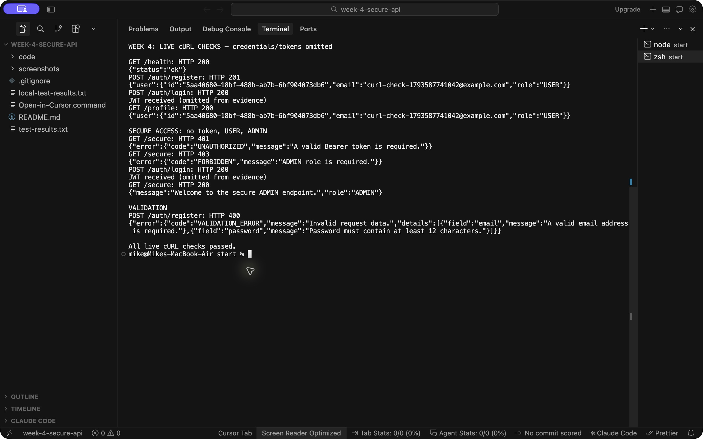

# Secure API Endpoint

## Project Description

A Node.js and TypeScript API demonstrating registration, login, protected routes, and role based authorization. It separates two questions: whether a request comes from an authenticated user and whether that user has permission to access a particular endpoint.

Built for Atlas School WD2200 Week 4, the project combines password hashing, JSON Web Tokens, input validation, rate limits, and structured logging.

## Usage / How It Works

After starting the server, use Postman or cURL to send requests to `http://localhost:3000`.

* `GET /health`: public health check.
* `POST /auth/register`: register a USER account.
* `POST /auth/login`: receive a JWT valid for one hour.
* `GET /profile`: view the authenticated user's profile.
* `GET /secure`: access an endpoint restricted to ADMIN accounts.

Registration and login accept a JSON body:

```json
{
  "email": "user@example.com",
  "password": "ExamplePassword123!"
}
```

Send the returned token in the `Authorization` header as `Bearer <token>`.

A missing or invalid token returns `401`. A USER attempting to access `/secure` receives `403`. An ADMIN receives `200`. Invalid registration input returns `400` with field messages.

## Installation

You need Git, Node.js 20 or newer, and npm.

```bash
git clone https://github.com/Mike-CX83/wd2200-week-4.git
cd wd2200-week-4/code/start
npm ci
cp .env.example .env
```

Before starting the server, edit the local `.env` file:

* `JWT_SECRET`: a random secret containing at least 32 characters.
* `ADMIN_EMAIL`: a valid email address for the demonstration administrator.
* `ADMIN_PASSWORD`: a password containing at least 12 characters.
* `PORT`: defaults to `3000`.
* `CORS_ORIGIN`: the permitted browser origin.
* `LOG_DIR`: the directory for application logs.

Do not commit `.env`. On Windows, copy `.env.example` to `.env` using your editor or file manager if `cp` is unavailable.

Build and start the API:

```bash
npm run build
npm start
```

For development with automatic restarts:

```bash
npm run dev
```

## Quick Verification

With the server running:

```bash
curl -i http://localhost:3000/health
```

Then register a user, log in, and use the returned token with `/profile`. Check that the same USER token receives `403` from `/secure`. Log in with the administrator credentials from `.env` to verify ADMIN access.

Passwords must contain at least 12 characters and no more than 72 UTF8 bytes.

## Tech Stack

* Node.js, TypeScript, and Express 5.
* bcryptjs for password hashing.
* jsonwebtoken for JWT signing and verification.
* express-validator for input validation.
* Helmet, CORS, and express-rate-limit for request controls.
* Morgan and Winston for request and application logs.
* Node's test runner and Supertest for integration tests.

## Tests

From `code/start`, run:

```bash
npm test
npm run typecheck
```

The integration suite is in `code/start/test/api.test.ts`. The repository includes screenshots from earlier local verification.



[Startup screenshot](screenshots/01-api-startup.png)  
[Request and error logs](screenshots/03-request-and-error-logs.png)

## Current Limitations

Accounts are stored in memory and reset when the server restarts. This project demonstrates API controls; it does not include a persistent database or a complete production identity system.

Logs are written to the console and the configured log directory. Keep credentials, tokens, runtime logs, dependencies, and build output out of the repository.

## Author

**Mike Hankins**  
Atlas School software engineering student with a background in nursing and an interest in systems design.

[GitHub profile](https://github.com/Mike-CX83)
